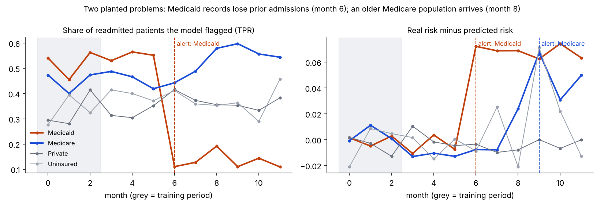
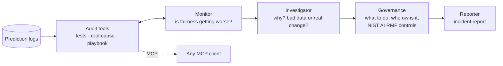

# DriftWatch

### Your AI model was fair at launch. Is it still?


Most teams check a model for bias once, before launch. Then the world changes. A hospital
changes how it records prior admissions for one insurance group, and the readmission model
quietly stops flagging those patients for follow-up care. Overall accuracy barely moves.
Nobody notices for months.

**DriftWatch is a multi-agent auditor that watches a deployed model's prediction logs,
catches fairness drift for each group, finds out why it happened, and recommends the fix,
mapped to the NIST AI Risk Management Framework.** Statistics do the math. Agents do the judgment.



**Results on 39 audits with known answers (3 OpenAI models):** every system found **20 of 24**
planted incidents with **zero false alarms**, including **0 alarms in 18 audits where nothing was wrong**.
Every incident found got the right start month (within 1), the right cause, the right cause type,
and the right action. The agent team matches the statistics exactly and adds the
investigation, the NIST AI RMF mapping, and a report a governance committee can read.

---

## How it works



| Agent | Tools | Job |
| --- | --- | --- |
| **Monitor** | `detect_fairness_drift`, `fairness_trend`, `data_overview` | Confirm which groups got worse, and since when |
| **Investigator** | `find_root_cause`, `fairness_trend` | Decide: is the **data** wrong, or did the **patients** really change? |
| **Governance** | `lookup_governance` | Pick the action and owner, and map to NIST AI RMF controls |
| **Reporter** | none | Write the report for the governance committee, using only the facts found |

The question the Investigator answers is the one that matters most in practice:

- **Data quality problem.** An input shifted for one group, but their real outcomes did not.
  Retraining would bake the error in. **Fix the data pipeline.**
- **Population change.** The group's patients really changed and the model now under-predicts
  their risk. **Recalibrate or retrain.**

DriftWatch tells them apart with a difference-in-differences check: how much did a feature shift
in this group *beyond* the shift in every other group, and did the group's real outcome rate change
significantly?

### The statistics (no LLM involved)

- **Metrics per group and month:** true positive rate (equal opportunity), calibration gap
  (real risk minus predicted risk), and selection rate.
- **Detection:** two-month pooled windows compared with the training period, using
  two-proportion and calibration z-tests with a Bonferroni correction across every group,
  window, and metric. An alert also needs a minimum effect size (10 points of TPR, or 3 points
  of calibration), so tiny but "significant" changes don't page anyone.
- **Root cause:** Population Stability Index (PSI) per feature, in the group minus in the others,
  plus a significance test on the group's outcome rate.

---

## Quickstart

```bash
git clone https://github.com/ghelaw01/Drift-Watch-Agents && cd Drift-Watch-Agents
pip install -e ".[dev]"
python -m pytest                                  # 11 tests, no API key needed

dw simulate --out logs.csv                         # logs with a planted problem
dw audit logs.csv --rules-only                     # statistics only, no LLM
export OPENAI_API_KEY=sk-...
dw audit logs.csv                                  # the agent team (add --provider claude for Claude)
```

### Audit your own model

Your logs need one row per prediction with `month`, a group column, `score` (predicted
probability), `flagged` (the decision, 0/1), and the real outcome `readmitted` (0/1), plus the
input features. Point `--group-col` at your group column.

### Use the tools from any MCP client

```bash
dw serve logs.csv          # stdio MCP server: Claude Desktop, Cursor, or your own agents
```

---

## Benchmark

Real logs never tell you the right answer, so the benchmark plants it. A readmission model is
trained on months 0 to 2 and then runs for 12 months on 4,000 simulated patients a month.
Each scenario plants one kind of change at a known month:

| Kind | What changes | Right answer |
| --- | --- | --- |
| Undercoding | Prior admissions stop being recorded for one group; real risk is unchanged | Incident, data quality, fix the pipeline |
| Population shift | An older, sicker population joins one group | Incident, population change, recalibrate or retrain |
| Follow-up loss | A clinic closes; real risk rises, but the model **sees** the feature | **No fairness incident** (data drift is not always harm) |
| None | Nothing | No incident |

13 scenarios × 3 replicas with new random patients = **39 audits**, 24 real incidents, and
18 audits where the correct answer is "nothing to report".

| System | Audits fully correct | Incidents found | False incidents | Clean logs with an alarm | Start month (±1) | Cause feature | Cause type | Action | Tool calls / audit | Seconds / audit |
| --- | --- | --- | --- | --- | --- | --- | --- | --- | --- | --- |
| rules only (no LLM) | 35/39 | 20/24 | 0 | 0/18 | 20/20 | 20/20 | 20/20 | 20/20 | 0.0 | 0.2 |
| agent team: gpt-4.1-mini | 35/39 | 20/24 | 0 | 0/18 | 20/20 | 20/20 | 20/20 | 20/20 | 2.5 | 8.2 |
| agent team: gpt-4o-mini | 35/39 | 20/24 | 0 | 0/18 | 20/20 | 20/20 | 20/20 | 20/20 | 5.0 | 10.4 |
| agent team: gpt-5.4-mini | 35/39 | 20/24 | 0 | 0/18 | 20/20 | 20/20 | 20/20 | 20/20 | 3.5 | 8.4 |

What I learned:

- **The agents never invented an incident.** Every number comes from the tools, and in 234 agent
  audits (before and after the fix below) no agent reported a group the statistics did not flag.
- **But an agent did drop a real one.** In the first run, gpt-4.1-mini reported only the first of two
  incidents in 2 of 3 multi-incident audits, and gpt-5.4-mini once called a real data problem
  "unclear". Before this fix, fully correct audits were 35, 33, and 34 of 39 (gpt-4o-mini,
  gpt-4.1-mini, gpt-5.4-mini). Those first-run results are kept in `bench/results/before-coverage-check/`.
- **The fix is code, not a better prompt.** A coverage check now makes sure every group with a
  statistical alert gets investigated. After it, all three models reach 35/39. It stepped in once in 117 audits.
- **So why use agents at all?** The statistics decide *whether* something is wrong. The agents explain
  *why* and *what to do*, in words a committee can act on, and they can be asked follow-up questions.
  The benchmark makes sure that explanation never changes the facts.
- Cost: about 3,000 to 5,000 tokens and 8 to 10 seconds per audit.

Reproduce it:

```bash
python bench/run_bench.py --replicas 3 --models gpt-4.1-mini      # rules-only runs without --models
python bench/report.py
```

### Honest limits

- **Weak, small shifts are missed.** A mild population shift in the Private group
  (strength 0.7) was missed in all 3 replicas, and undercoding in the smallest group
  (Uninsured, 7% of patients) was missed in 1 of 3. That is the price of zero false alarms.
- **The data is simulated.** The benchmark measures whether the method finds planted problems;
  it is not a clinical validation.
- The NIST AI RMF mapping is a starting point that I wrote from the framework's text, not legal or
  compliance advice. Check the [official playbook](https://airc.nist.gov/airmf-resources/playbook/).

## Project layout

| Path | What it is |
| --- | --- |
| `src/driftwatch/analysis.py` | Fairness metrics, drift tests, PSI root cause |
| `src/driftwatch/agents.py` | Monitor, Investigator, Governance, Reporter; and the rules-only baseline |
| `src/driftwatch/tools.py` | The audit tools the agents call |
| `src/driftwatch/server.py` | The same tools as an MCP server |
| `src/driftwatch/governance.py` | Playbook and NIST AI RMF 1.0 mapping |
| `src/driftwatch/simulate.py` | Simulated hospital logs with planted, known problems |
| `src/driftwatch/llm.py` | One tool-calling interface for OpenAI and Claude |
| `bench/` | Benchmark runner and report |

## Roadmap

- Intersectional groups (for example payer × age band)
- Sequential tests (CUSUM) for faster detection
- Scheduled audits that open a ticket when an incident is found
- Real-world validation on public datasets

## License

MIT. Built by [Zemen Ghelaw](https://github.com/ghelaw01), with AI assistance.
