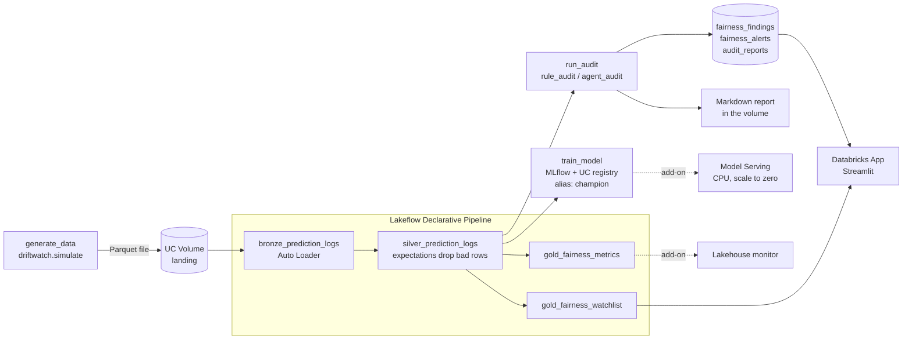

# DriftWatch on Databricks

This folder runs DriftWatch end to end on Databricks.
It is a **Databricks Asset Bundle**. A bundle is a set of YAML files that describes jobs,
pipelines, models, and apps as code. One command deploys all of it.

It is built for **Databricks Free Edition**. Everything uses serverless compute.
There are no cluster definitions and no GPUs.

> **Status:** ready to deploy. It has been validated and tested offline (see
> [What was tested](#what-was-tested)). It has not been run on a real workspace yet.

---

## What it does

Every run of the job does five steps:

1. **Generate data.** It simulates one batch of hospital readmission prediction logs.
   It plants a known fairness problem (for example, Medicaid prior admissions stop being recorded).
2. **Refresh the pipeline.** Raw files become clean tables: bronze, then silver, then gold.
3. **Train the model (optional).** It trains the readmission model, logs it to MLflow,
   and registers it in Unity Catalog.
4. **Audit.** It runs the DriftWatch audit on the new batch.
   The statistics always run. The agent team runs only if an LLM key is available.
5. **Save the results.** Findings go to Delta tables. The report goes to a volume.
   A Databricks App shows the results.



## Databricks features used, and why

| Feature | Where | What it does here |
| --- | --- | --- |
| **Asset Bundle** | `databricks.yml`, `resources/` | All resources as code. `dev` and `prod` targets. |
| **Unity Catalog** | `resources/unity_catalog.yml` | One schema holds every table, the volume, and the model. |
| **UC Volume** | `landing` volume | Raw prediction log files (bronze input) and Markdown reports. |
| **Lakeflow Declarative Pipeline** (formerly Delta Live Tables) | `resources/pipeline.yml`, `src/pipeline/` | Bronze, silver, and gold tables. Serverless. |
| **Auto Loader** | bronze table | Picks up only the new files in the volume. |
| **Expectations** (data quality rules) | silver table | 5 rules drop bad rows. 4 rules only count problems. |
| **Delta Lake** | every table | Findings history, alerts, and reports are appended per batch. |
| **Pipeline event log** | `pipeline_event_log` table | Data quality results you can query with SQL. |
| **MLflow tracking** | `resources/unity_catalog.yml` (experiment) | Params, metrics, fairness per payer, signature, input example. |
| **UC model registry** | `readmission_model` | Each training run makes a new version. A gate sets the `champion` alias. |
| **Lakeflow Job** | `resources/job.yml` | 5 tasks, a condition task, a daily schedule (paused). Serverless. |
| **Python wheel tasks** | `artifacts` in `databricks.yml` | The bundle builds 2 wheels and installs them in the job environment. |
| **Secret scope** | `resources/unity_catalog.yml` | Holds an optional Anthropic or OpenAI key. |
| **Databricks App** | `resources/app.yml`, `app/` | Streamlit page: alerts, group trends, NIST AI RMF controls. |
| **Model Serving** (add-on) | `addons/serving/` | Serves the champion model. CPU, Small, scale to zero. |
| **AI Gateway** (add-on, off) | `addons/serving/` | Inference table and usage tracking. Turn on with a variable. |
| **Lakehouse monitor** (add-on, off) | `addons/monitor/` | Profiles the gold metrics table. |
| **GitHub Actions CI/CD** | `.github/workflows/databricks.yml` | Tests, then validates and deploys `prod`. |

### Why are serving and the monitor separate?

A serving endpoint needs a model version that already exists.
A monitor needs a table that already exists.
On the very first deploy, neither exists yet. The job creates them.
So they live in two small extra bundles: `addons/serving` and `addons/monitor`.
You deploy them after the first job run. CI can do it for you.

## Tables

All in `<catalog>.<schema>` (default `workspace.driftwatch`).

| Table | Written by | One row per |
| --- | --- | --- |
| `bronze_prediction_logs` | pipeline | patient prediction (raw) |
| `silver_prediction_logs` | pipeline | patient prediction (clean) |
| `gold_fairness_metrics` | pipeline | batch, month, payer group |
| `gold_fairness_watchlist` | pipeline | batch, month, payer group, with change from baseline |
| `fairness_alerts` | audit task | statistical alert |
| `fairness_findings` | audit task | incident, with cause, action, owner, NIST controls |
| `audit_reports` | audit task | audit run, with the Markdown report |
| `pipeline_event_log` | pipeline | pipeline event |

The watchlist flags are only a quick effect-size screen.
The real alerts use significance tests with a Bonferroni correction. They are in `fairness_alerts`.

## Free Edition notes

- **Serverless only.** Every job task and the pipeline are serverless. No cluster settings.
- **5 tasks at once.** The job has 5 tasks, and they run one after another.
- **1 active pipeline per type.** There is one pipeline. It is triggered, not continuous.
- **One small SQL warehouse.** The app uses the default "Serverless Starter Warehouse".
  The bundle finds its id by name.
- **3 apps, stopped after 24 hours.** `dev` and `prod` make 2 apps. Deploy does not start them.
- **Limited model serving, CPU only.** The endpoint is CPU, Small, and scales to zero.
- **Limited outbound internet.** The agent team needs api.anthropic.com or api.openai.com.
  These may be blocked. If so, the audit uses the rules only and says so in the report.
  The job does not fail.
- **The schedule is paused.** The daily run does not start until you un-pause it.

---

## Setup, step by step

### 1. Create a Free Edition workspace

1. Go to the Databricks Free Edition sign-up page and create an account.
2. Wait until your workspace opens in the browser.

### 2. Find your host URL

Look at the browser address bar. Copy the part up to `.com`. For example:
`https://dbc-a1b2c3d4-e5f6.cloud.databricks.com`.
This is `DATABRICKS_HOST`.

### 3. Create a personal access token

1. Click your user icon (top right), then **Settings**.
2. Open **Developer**. Next to **Access tokens**, click **Manage**.
3. Click **Generate new token**. Give it a name, like `github-driftwatch`. Pick a lifetime (for example 90 days).
4. Copy the token now. You cannot see it again. This is `DATABRICKS_TOKEN`.

Never put the token in a file or a commit. Only put it in GitHub secrets.

### 4. (Optional) Find your SQL warehouse id

You can skip this step. The bundle looks up the warehouse named "Serverless Starter Warehouse".
If yours has another name:

1. Click **SQL Warehouses** in the left menu. Open your warehouse.
2. Open **Connection details**. The id is the last part of the HTTP path:
   `/sql/1.0/warehouses/<id>`.

### 5. Add the GitHub secrets and variables

In GitHub, open the repository. Go to **Settings > Secrets and variables > Actions**.

On the **Secrets** tab, add two repository secrets:

| Name | Value |
| --- | --- |
| `DATABRICKS_HOST` | the host URL from step 2 |
| `DATABRICKS_TOKEN` | the token from step 3 |

On the **Variables** tab you can add these. All of them are optional.

| Name | Default | Meaning |
| --- | --- | --- |
| `DATABRICKS_WAREHOUSE_ID` | looked up by name | SQL warehouse for the app |
| `DATABRICKS_CATALOG` | `workspace` | catalog to use |
| `DATABRICKS_SCHEMA` | `driftwatch` | schema to create |
| `DATABRICKS_DEPLOY_SERVING` | not set | `true` deploys the serving endpoint (after the first job run) |
| `DATABRICKS_DEPLOY_MONITOR` | not set | `true` deploys the Lakehouse monitor (after the first job run) |

Without the secrets, the workflow still runs the tests. It skips the deploy with a notice.

### 6. Deploy and run

1. Go to the **Actions** tab. Open the **databricks** workflow.
2. Click **Run workflow**. Tick **Run the DriftWatch job after deploying**. Pick a scenario.
3. Wait. The first run takes about 10 to 15 minutes. Serverless start-up and package install take most of it.

A push to `main` that changes `databricks/**` or `src/**` also deploys. It does not run the job.

### 7. Look at the results

- **Jobs & Pipelines:** open `driftwatch-fairness-audit` to see the 5 tasks.
  Open `driftwatch-medallion` to see the pipeline graph and the data quality numbers.
- **Catalog:** open `workspace > driftwatch` to see the tables, the volume, and the model.
- **Experiments:** open `driftwatch-readmission-prod` to see the MLflow runs.

### 8. Open the app

1. Start it. Either run the workflow again with **Start the Databricks App** ticked,
   or click **Compute > Apps > driftwatch > Start**.
2. When it says **Running**, click the app URL.

The audit task gives the app permission to read the schema. So run the job at least once
after the app exists. If the app says it has no permission, run the job again.

### 9. (Optional) Turn on the agent team

The agents need an LLM key. Put it in the secret scope that the bundle created
(`driftwatch` in prod, `driftwatch-dev` in dev):

```bash
databricks secrets put-secret driftwatch anthropic_api_key   # or openai_api_key
```

The CLI asks for the value, so the key does not end up in your shell history.
The next job run uses the agents. If the call fails (for example, no outbound internet),
the report says so and the rules result is kept.

### 10. (Optional) Serve the model

After the first job run, the model has a `champion` version.

1. Set the GitHub variable `DATABRICKS_DEPLOY_SERVING` to `true`.
2. Run the workflow again. It reads the champion version and deploys `addons/serving`.

Test the endpoint. It returns two probabilities per patient (not readmitted, readmitted):

```bash
databricks serving-endpoints query driftwatch-readmission --json '{
  "dataframe_records": [{"age": 71, "prior_admissions": 2, "length_of_stay": 5.5,
                         "num_medications": 9, "has_followup": 1}]}'
```

The flagging threshold is saved as the model version tag `decision_threshold`.

To log requests to a table, deploy with `--var enable_inference_table=true`.
To track usage, use `--var enable_usage_tracking=true`.
Both are off by default, because I could not confirm that Free Edition supports them for custom models.

### 11. (Optional) The Lakehouse monitor

Set the GitHub variable `DATABRICKS_DEPLOY_MONITOR` to `true` and run the workflow.
It profiles `gold_fairness_metrics`, with one slice per payer group.
This is untested on Free Edition. If it fails there, set the variable back and ignore it.

---

## Save your Free Edition quota

- **The schedule is paused.** To run daily, deploy with `--var schedule_pause_status=UNPAUSED`.
- **Stop the app** when you are done: `databricks apps stop driftwatch`.
  Free Edition also stops it after 24 hours.
- **The serving endpoint scales to zero.** It costs nothing while nobody calls it.
- **Remove everything:**

  ```bash
  cd databricks/addons/serving && databricks bundle destroy -t prod
  cd ../monitor && databricks bundle destroy -t prod
  cd ../.. && databricks bundle destroy -t prod
  ```

  Destroy deletes the tables and the model too.

---

## Work from your laptop (dev target)

```bash
pip install -e . -e "./databricks[dev]"          # from the repository root
cd databricks
python -m pytest                                 # unit tests, no Databricks needed

databricks auth login --host https://<your-host>  # opens the browser once
databricks bundle validate                       # dev is the default target
databricks bundle deploy
databricks bundle run fairness_audit --params scenario=two_incidents
databricks bundle run driftwatch_app             # start the dev app
```

In **dev**, the bundle uses development mode. Names get your user prefix. For example,
the schema becomes `dev_<you>_driftwatch` and the job becomes `[dev <you>] driftwatch-fairness-audit`.
So your experiments never touch `prod`. The dev app is called `driftwatch-dev`.

Job parameters you can change per run:

| Parameter | Default | Meaning |
| --- | --- | --- |
| `scenario` | `medicaid_undercoding` | `none`, `medicaid_undercoding`, `medicare_population_shift`, `uninsured_followup_loss`, `two_incidents`, or a benchmark name like `drift-3` |
| `seed` | `auto` | random seed; `auto` gives new patients each run |
| `retrain` | `true` | `false` skips the training task |
| `train_window` | `baseline` | `recent` retrains on the last 3 months (shows how retraining on bad data hides the problem) |
| `agent_audit` | `auto` | `off` never calls an LLM |
| `fail_on_incident` | `false` | `true` makes the job fail when an incident is found (useful for alerts) |

---

## CI/CD

The workflow `.github/workflows/databricks.yml` has two jobs:

1. **test** runs on every matching push. It installs both packages and pyspark.
   It gets the official bundle JSON schema with `databricks bundle schema`.
   Then it runs `python -m pytest` in this folder.
2. **deploy** needs the test job. If the secrets are missing, every step is skipped.
   Otherwise it runs `databricks bundle validate -t prod`, then `databricks bundle deploy -t prod`.
   On a manual run it can also run the job and start the app.
   With the add-on variables set, it also deploys serving and the monitor.

The Databricks CLI is pinned: action `databricks/setup-cli@v1.23.0`, CLI version `1.23.0`.

### A safer login: OIDC (workload identity federation)

A personal access token is simple, but it is a long-lived secret.
The more secure option is **workload identity federation (OIDC)**.
GitHub gives each workflow run a short-lived identity token. Databricks trusts it.
Then there is no Databricks secret in GitHub at all.

It needs a service principal, so it may not be possible on Free Edition.
On a paid workspace, the steps are:

1. Create a service principal. Give it access to the workspace and the catalog.
2. Add a federation policy to it. Issuer: `https://token.actions.githubusercontent.com`.
   Audience: your Databricks account id. Subject: `repo:ghelaw01/Drift-Watch-Agents:ref:refs/heads/main`.
3. In the workflow, give the deploy job `permissions: id-token: write`.
4. Replace `DATABRICKS_TOKEN` with these environment variables:
   `DATABRICKS_AUTH_TYPE: github-oidc` and `DATABRICKS_CLIENT_ID: <service principal application id>`.
   Keep `DATABRICKS_HOST`.
5. In `databricks.yml`, set `run_as: service_principal_name: <application id>` for `prod`.
6. Delete the `DATABRICKS_TOKEN` secret.

Check the Databricks documentation page "Enable workload identity federation for GitHub Actions"
for the current details.

---

## Folder layout

| Path | What it is |
| --- | --- |
| `databricks.yml` | Bundle name, variables, wheel artifacts, `dev` and `prod` targets |
| `resources/unity_catalog.yml` | Schema, volume, registered model, MLflow experiment, secret scope |
| `resources/pipeline.yml` | The Lakeflow Declarative Pipeline |
| `resources/job.yml` | The job: tasks, parameters, schedule, serverless environment |
| `resources/app.yml` | The Databricks App and its SQL warehouse resource |
| `src/pipeline/driftwatch_pipeline.py` | Bronze, silver, gold table definitions (`import dlt`) |
| `src/driftwatch_databricks/` | Python package: rules, metrics, training, audit, task entry points |
| `app/` | Streamlit app (`app.py`, `queries.py`, `app.yaml`, `requirements.txt`) |
| `addons/serving/` | Separate bundle: Model Serving endpoint |
| `addons/monitor/` | Separate bundle: Lakehouse monitor |
| `tests/` | Unit tests (pandas), Spark parity tests, bundle checks |

The code reuses the core package. The audit calls `driftwatch.tools.Toolbox`,
`driftwatch.agents.rule_audit`, and `driftwatch.agents.agent_audit` without changes.

---

## What was tested

Offline, without a Databricks workspace:

- **Official bundle schema.** Every YAML file passes the JSON schema from
  `databricks bundle schema` (CLI 1.23.0 and 1.24.0). CI repeats this on every run.
- **`databricks bundle validate`** passes for all three bundles and both targets, with
  CLI 1.23.0 and 1.24.0. The CLI was pointed at a local mock of the Databricks API.
- **`databricks bundle deploy`** against the same mock: both wheels built, all resources
  were sent with the right names and paths. This shows the config is complete.
  It does not prove the real workspace accepts it.
- **Unit tests:** `python -m pytest` in this folder. They cover data generation, the data quality
  rules, gold metrics, training and MLflow logging, the audit and its fallback, the app's SQL,
  and the bundle files. With pyspark installed, they also check that the Spark code
  gives the same numbers as the pandas code, and they run the pipeline file with a stand-in `dlt`.

Not tested yet (needs a real workspace):

- Auto Loader and streaming tables in the real pipeline runtime.
- The serverless environment install (`environment_version: "4"`).
- Model registration in Unity Catalog, and the serving endpoint.
- The app on the Apps runtime, and the schema grant to the app's service principal.
- Lakehouse monitoring, inference tables, and usage tracking on Free Edition.

## Troubleshooting

| Problem | What to do |
| --- | --- |
| `lookup warehouse ... not found` | Your warehouse has another name. Set `DATABRICKS_WAREHOUSE_ID` (or `--var warehouse_id=<id>`). |
| Pipeline fails: path does not exist | Run the whole job, not only the pipeline. `generate_data` writes the first file. |
| `No silver rows for batch` | The pipeline did not pick up the new file. Open the pipeline and check the bronze table. Then rerun the job. |
| Tasks wait in the queue | Free Edition limits concurrent work. The job queues instead of failing. Wait, or stop other jobs. |
| Package install fails on the environment | Try `--var serverless_env_version=3`. Check that PyPI is reachable from serverless. |
| Agent audit "failed, kept the rules-only audit" | Expected when outbound internet is blocked. The rules audit is complete on its own. |
| App: "No audit results yet" | Run the job once. The audit task also grants the app read access. Then click **Refresh data**. |
| App: permission denied on a table | The app was created after the last job run. Run the job again, or run this as the owner: `GRANT USE SCHEMA, SELECT ON SCHEMA workspace.driftwatch TO \`<app service principal id>\``. |
| Serving deploy: model version not found | Run the job with `retrain=true` first. Check the model has a `champion` alias. |
| `apps` limit reached | Free Edition allows 3 apps. Delete one you do not use. |
| Dev and prod names | Dev mode adds a `dev_<you>_` prefix to the schema, model, and endpoint. That is normal. |
| `databricks bundle deploy` asks to approve | CI passes `--auto-approve`. On a laptop, read the plan first. Destroying a schema deletes its tables. |
